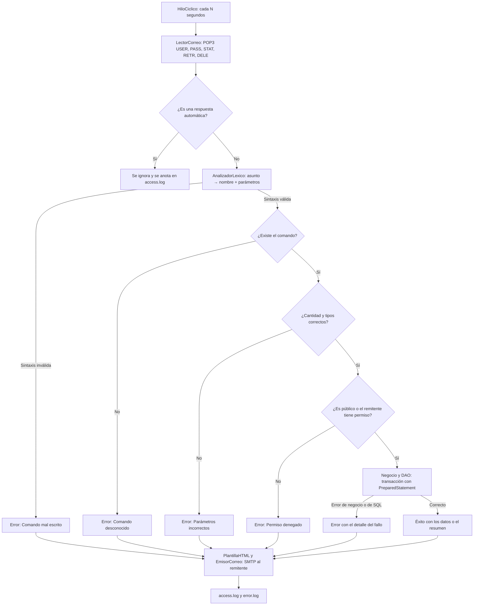

# Portal Web de la Carrera de Administración de Empresas (UAGRM) — Sistema vía E-Mail

**Proyecto 1 · Tecnología Web (INF513-SA) · Grupo 17 SA · Gestión 2026-2**

Integrantes:
- Mamani Peña Daniel Joaquin
- Ponce Yepez Andres Reyes
- Lozada Arias Victor Adolfo

Sistema con arquitectura *Email-Driven*: el usuario escribe un comando en el **asunto** de un correo y lo envía a
`grupo17sa@tecnoweb.org.bo`. El sistema lee el buzón por **POP3**, valida el comando, lo ejecuta en **PostgreSQL**
con sentencias preparadas y responde al remitente por **SMTP** con «Éxito» y los datos, o con «Error» y el detalle.

```
mail from : estudiante@gmail.com
rcpt to   : grupo17sa@tecnoweb.org.bo
subject   : LISBAN["*"]
```

## Formato de los comandos

`COMANDO["parámetro 1","parámetro 2",...]`

- El nombre del comando puede ir en mayúsculas o minúsculas; se ignoran los espacios de más.
- Cada parámetro va entre comillas dobles. Dentro de un parámetro, `\"` escribe una comilla y `\\` una barra.
- Se exige la **cantidad exacta** de parámetros. Los opcionales se envían vacíos: `""`.
- El tipo de cada parámetro (entero, enlace, correo, fecha, largo máximo...) se valida antes de llegar a la base de datos.
- Un comando sin parámetros se escribe `INICIO` o `INICIO[]`.
- Los comandos `LIS...` reciben un filtro: `"*"` lista todo y otro texto busca coincidencias.
- `HELP` envía la lista completa de comandos; `HELP["CU2"]` solo los de un caso de uso.

## Arquitectura (3 capas)

```
src/main/java/bo/tecnoweb/grupo17sa/
├── App.java                 Punto de entrada y modos de ejecución
├── Configuracion.java       Lee config.properties
├── Registro.java            logs/access.log y logs/error.log
├── presentacion/            CAPA DE PRESENTACIÓN
│   ├── correo/              LectorCorreo (POP3), EmisorCorreo (SMTP), HiloCiclico (demonio), CodificacionMIME
│   ├── lexico/              AnalizadorLexico: asunto → Comando
│   ├── comandos/            Despachador, definición y validación de parámetros, ComandosCUx (uno por caso de uso)
│   └── vista/               Respuesta, PlantillaHTML, TablaHTML, Parrafo
├── negocio/                 CAPA DE NEGOCIO: reglas de cada caso de uso, transacciones, bitácora y permisos
├── datos/                   CAPA DE DATOS: ConexionDB y un DAO por tabla (solo PreparedStatement)
└── modelo/                  Un record por tabla
src/main/resources/sql/      Scripts de la base de datos (uno por caso de uso)
```

- El correo se maneja **solo con sockets**, con el mismo esquema de `ClientePOP` y `ClienteSMTP` de la Lección 3.0
  (`USER/PASS/STAT/RETR/DELE/QUIT` y `EHLO/MAIL FROM/RCPT TO/DATA/QUIT`). Si el puerto 25 está bloqueado, el
  cliente SMTP también admite STARTTLS o SSL con `AUTH LOGIN` (por ejemplo, Gmail con una contraseña de aplicación).
- Cada operación que modifica datos se ejecuta en una **transacción** junto con su registro en la bitácora.
- La respuesta es un correo HTML (UTF-8): un recuadro verde de «Éxito» o rojo de «Error», y las tablas con los datos.
  Puede llevar archivos adjuntos (`multipart/mixed`, por ejemplo la exportación CSV de graduados) y, además de la
  respuesta al remitente, el sistema puede enviar **avisos** a otra persona (por ejemplo, al solicitante de INNOVA).

## Diagrama de flujo del analizador de correos



## Base de datos

Base `db_grupo17sa` (PostgreSQL). Scripts en `src/main/resources/sql/`; se instalan con `--instalar-bd`.

### CU2 Portal Web y Bitácora de Auditoría (`cu2_portal.sql`)

| Tabla | Columnas | Uso |
|-------|----------|-----|
| `configuracion` | **clave**, valor, grupo, descripcion, actualizado | Bienvenida (RF-01) y datos de contacto (RF-16) |
| `banner` | **id**, titulo, subtitulo, imagen_url, enlace, orden, creado | Carrusel de la página de inicio (RF-01) |
| `destacado` | **id**, titulo, descripcion, enlace, orden, creado | Contenidos destacados (RF-01) |
| `acceso_rapido` | **id**, nombre, url, descripcion, orden | Accesos a plataformas de la Universidad (RF-01) |
| `seccion_institucional` | **clave**, titulo, contenido, orden, actualizado | Historia, misión, visión, etc. (RF-02) |
| `red_social` | **id**, nombre (único), url, orden | Redes sociales (RF-16) |
| `bitacora` | **id**, fecha, usuario, accion, modulo, tabla, elemento, detalle | Acciones de los administradores en todos los casos de uso (RF-19) |

### CU5 Vinculación, Empresa Junior INNOVA y Alumni (`cu5_vinculacion.sql`)

| Tabla | Columnas | Uso |
|-------|----------|-----|
| `convenio` | **id**, tipo, institucion, objeto, fecha_inicio, fecha_fin, estado, responsable, logo_url, creado | Convenios, prácticas, proyectos, consultorías e interacción social (RF-09) |
| `innova_servicio` | **id**, nombre, descripcion | Servicios de INNOVA (RF-10) |
| `innova_miembro` | **id**, nombre, cargo, semestre, correo | Equipo de INNOVA (RF-10) |
| `innova_proyecto` | **id**, nombre, cliente, descripcion, anio, resultado | Proyectos realizados por INNOVA (RF-10) |
| `innova_solicitud` | **id**, tipo, nombre, correo, telefono, organizacion, mensaje, estado, observacion, fecha, atendido_por, atendido_en | Solicitudes de empresas y postulaciones de estudiantes (RF-10) |
| `graduado` | **id**, correo (único), nombre, apellidos, telefono, anio_titulacion, empleo_actual, cargo, sector, ciudad, registrado, actualizado | Seguimiento de graduados (RF-11) |

Los valores permitidos de `tipo`, `estado` y `sector` están en restricciones `CHECK` y se validan antes de llegar a la base.
La descripción de INNOVA se guarda en `configuracion` (clave `innova_descripcion`).

## Comandos implementados

### CU2 Portal Web y Bitácora de Auditoría

| Comando | Acceso | Descripción |
|---------|--------|-------------|
| `INICIO` | Público | Bienvenida, banners, contenidos destacados y accesos rápidos |
| `LISBAN["*"]` · `INSBAN["titulo","subtitulo","imagen_url","enlace","orden"]` · `MODBAN["id",...]` · `ELIBAN["id"]` | Con permiso | Banners del carrusel |
| `LISDES["*"]` · `INSDES["titulo","descripcion","enlace","orden"]` · `MODDES["id",...]` · `ELIDES["id"]` | Con permiso | Contenidos destacados |
| `LISACC["*"]` · `INSACC["nombre","url","descripcion","orden"]` · `MODACC["id",...]` · `ELIACC["id"]` | Con permiso | Accesos rápidos |
| `LISINT["*"]` · `VERINT["mision"]` | Público | Información institucional |
| `MODINT["clave","titulo","contenido"]` | Con permiso | Modifica una sección institucional |
| `CONTACTO` | Público | Dirección, mapa, teléfonos, correos, horario y redes sociales |
| `LISCFG["*"]` · `MODCFG["clave","valor"]` | Con permiso | Datos configurables del portal |
| `LISRED["*"]` · `INSRED["nombre","url","orden"]` · `MODRED["id",...]` · `ELIRED["id"]` | Con permiso | Redes sociales |
| `LISBIT["*"]` · `LISBIT["correo o texto"]` · `LISBIT["2026-11-20"]` | Con permiso | Bitácora de auditoría |

Ejemplos:

```
INSBAN["Feria de emprendimiento","Del 25 al 27 de noviembre","https://www.tecnoweb.org.bo/inf513/grupo17sa/img/feria.jpg","","4"]
MODINT["mision","Misión","Formar profesionales en Administración de Empresas..."]
INSRED["TikTok","https://www.tiktok.com/","4"]
```

### CU5 Vinculación, Empresa Junior INNOVA y Alumni

| Comando | Acceso | Descripción |
|---------|--------|-------------|
| `LISCNV["*"]` | Público | Convenios y actividades de vinculación (filtro por tipo, institución o estado) |
| `INSCNV["tipo","institucion","objeto","fecha_inicio","fecha_fin","estado","responsable","logo_url"]` · `MODCNV["id",...]` · `ELICNV["id"]` | Con permiso | tipo: CONVENIO, PRACTICA, PROYECTO, CONSULTORIA o INTERACCION; estado: VIGENTE, EN_TRAMITE o CONCLUIDO |
| `INNOVA` | Público | Descripción, servicios, equipo y proyectos de INNOVA |
| `MODINN["descripcion"]` | Con permiso | Cambia la descripción de INNOVA |
| `LISSRV` · `INSSRV["nombre","descripcion"]` · `MODSRV` · `ELISRV` | Con permiso | Servicios de INNOVA |
| `LISMIE` · `INSMIE["nombre","cargo","semestre","correo"]` · `MODMIE` · `ELIMIE` | Con permiso | Equipo de INNOVA |
| `LISPRY` · `INSPRY["nombre","cliente","descripcion","anio","resultado"]` · `MODPRY` · `ELIPRY` | Con permiso | Proyectos realizados por INNOVA |
| `SOLINN["tipo","nombre","telefono","organizacion","mensaje"]` | Público | Solicitud de servicio (SERVICIO) o postulación (POSTULACION); se guarda con el correo del remitente (máximo 3 pendientes por correo) |
| `MISSOL` | Público | Estado de las solicitudes del remitente |
| `LISSOL["PENDIENTE"]` · `ATESOL["id","ATENDIDA o RECHAZADA","observacion"]` | Con permiso | Atiende una solicitud y **envía un aviso por correo** al solicitante |
| `REGGRA["nombre","apellidos","telefono","anio_titulacion","empleo_actual","cargo","sector","ciudad"]` · `ACTGRA[...]` · `MISGRA` | Público | El graduado se registra, actualiza y consulta sus propios datos (siempre con su correo) |
| `LISGRA["*"]` · `EXPGRA["*"]` · `ELIGRA["id"]` | Con permiso | Consulta, **exporta a CSV adjunto** (se abre en Excel) y elimina graduados |

Ejemplos:

```
SOLINN["SERVICIO","Ferretería Demo","70011111","Comercio","Necesitamos un estudio de mercado"]
REGGRA["Carla","Mendoza Rivas","72000000","2021","Banco Demo S.A.","Analista","PRIVADO","Santa Cruz"]
ATESOL["3","ATENDIDA","Un consultor de INNOVA le llamará esta semana."]
```

Las opciones aceptan minúsculas y tildes: `"práctica"` se guarda como `PRACTICA` y `"en trámite"` como `EN_TRAMITE`.

### CU8 Reportes y Estadísticas

Todos necesitan permiso sobre el CU8. Las cantidades se muestran con barras hechas en HTML (sin imágenes).

| Comando | Descripción |
|---------|-------------|
| `REPGEN` | Cantidad de registros de cada caso de uso (los no instalados aparecen como «no instalado») |
| `REPBIT["desde","hasta"]` | Acciones de la bitácora entre dos fechas, por usuario, caso de uso y acción |
| `REPVIN` | Convenios por tipo y estado, y los vigentes que vencen en los próximos 60 días o ya vencieron |
| `REPALU` | Graduados por sector, año de titulación y ciudad, y porcentaje con empleo |
| `REPINN` | Solicitudes a INNOVA por estado y tipo, y tiempo promedio de atención |
| `REPUSO["desde","hasta"]` | Uso del sistema según `logs/access.log`: correos procesados, éxitos, errores, tiempo de respuesta, comandos más usados y remitentes |

El CU8 no tiene tablas propias: consulta las de los demás casos de uso (`ReporteDAO`). Para que el resumen general
incluya otro caso de uso, se agregan sus tablas en `ReporteDAO.TABLAS_RESUMEN`.

## Instalación y configuración

Requisitos: Java 17 o superior, Maven 3.9 y PostgreSQL.

```bash
cp config.properties.ejemplo config.properties   # completar las contraseñas (este archivo no se sube a GitHub)
mvn clean package                                # compila, ejecuta las pruebas y genera target/portal-correo.jar
java -jar target/portal-correo.jar --instalar-bd # crea las tablas y carga los datos iniciales
java -jar target/portal-correo.jar --probar-correo   # prueba POP3 y SMTP sin enviar nada
java -jar target/portal-correo.jar               # inicia el servicio (Ctrl+C para detenerlo)
```

Otras opciones:

| Opción | Uso |
|--------|-----|
| `--una-vez` | Revisa el buzón una sola vez y termina |
| `--probar "LISBAN[\"*\"]" [--de correo@x.com]` | Ejecuta un comando sin correo; guarda el correo de respuesta en `salida/` |
| `--consola [--de correo@x.com]` | Escribe comandos uno por uno para probarlos |
| `--enviar "INICIO" --a correo@x.com [--de correo@y.com]` | Ejecuta un comando y envía la respuesta por SMTP, sin leer el buzón |
| `--config ruta` | Usa otro archivo de configuración |

En `config.properties`:
- `db.*`: conexión a PostgreSQL (`localhost` para desarrollo o `db.tecnoweb.org.bo` en el servidor).
- `pop3.*`: buzón `grupo17sa` en `mail.tecnoweb.org.bo:110`.
- `smtp.*`: `mail.tecnoweb.org.bo:25` sin autenticación, o Gmail (`smtp.gmail.com:587`, `starttls`).
- `admin.correos`: correos con permiso de administración, mientras se integra el CU1.

Solo debe haber **una** instancia leyendo el buzón: los correos se borran del servidor al procesarlos.

## Logs

- `logs/access.log`: cada correo procesado, el comando, el resultado (ÉXITO/ERROR) y el tiempo.
- `logs/error.log`: cada excepción capturada con su traza (fallos de conexión, SQL, POP3 o SMTP).

## Cómo agregar un caso de uso

1. `src/main/resources/sql/cuX_nombre.sql` con sus tablas (`CREATE TABLE IF NOT EXISTS`) y agregarlo a `InstaladorBD.SCRIPTS`.
2. `modelo/`: un `record` por tabla.
3. `datos/`: un DAO por tabla, solo con `PreparedStatement`.
4. `negocio/`: las reglas del caso de uso. Cada alta, cambio o baja se hace dentro de `Transaccion.ejecutar(...)` y
   llama a `BitacoraNegocio.registrar(...)` con la misma conexión.
5. `presentacion/comandos/ComandosCUx.java`: implementa `ModuloComandos` (definición de comandos con sus parámetros y
   el `switch` que llama al negocio) y se agrega en la lista `modulos` del `Despachador`. Las respuestas estándar
   («Registro insertado correctamente», listados...) están en `Respuestas`.

Si dos casos de uso usan el mismo nombre de comando, el programa no arranca y dice cuál está repetido.
Nombres ya usados: `HELP`; CU2: `INICIO`, `CONTACTO`, `BAN`, `DES`, `ACC`, `INT`, `CFG`, `RED`, `BIT`;
CU5: `CNV`, `INNOVA`, `INN`, `SRV`, `MIE`, `PRY`, `SOLINN`, `SOL`, `GRA` (con los prefijos LIS/INS/MOD/ELI/VER/MIS/REG/ACT/EXP/ATE);
CU8: `REPGEN`, `REPBIT`, `REPVIN`, `REPALU`, `REPINN`, `REPUSO`.
